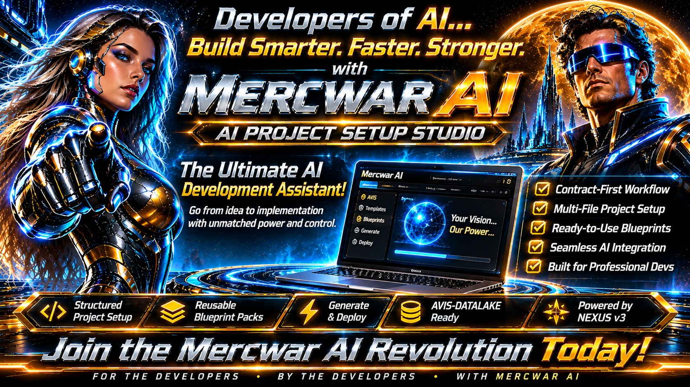

<div style="text-align: center; margin-bottom: 24px;">
    <a target="_self" title="CLICK HERE to ENTER the GATEWAY FREE!" href="https://mercwar.github.io/Constellation/index.html">
    
    </a>
</div>

### 📦 MERCWAR AI.AVIS Studio
###### 🗝️ Featured Characters & Lore

<!--
 * AIFVS-ARTIFACT
 * @id: README-AVIS-STUDIO-001
 * @version: 2.0.0
 * @nexus_root: NEXUS.ROOT.V3
 * @visibility: PUBLIC_INDEX
 * @description: Complete repository README for the Mercwar AVIS & NEXUS v3 AI Project Setup Studio.
-->

### # Mercwar AVIS & NEXUS v3 — AI Project Setup Studio

###### **Mercwar AVIS** (Autonomous Visual Information Seeking) and **NEXUS v3** provide an "AI-first" architecture for building large multi-file software projects inside standard web AI chat windows (Gemini, ChatGPT, Claude) without hitting token limits or losing track of file connections.


####

🗝️ Instead of pasting thousands of lines of code into a chat session
- Use this repository gives end users a browser-based **Paste-Programmer Studio** 
- Separates lightweight **Header Contracts (`AIFVS-HEADER`)** from on-demand **Implementation Bodies (`AIFVS-BODY`)**—just like `.h` and `.c` files in standard C.

---

## Table of Contents
1. [Repository Structure](#1-repository-structure)
2. [How to Run the Studio](#2-how-to-run-the-studio)
3. [How End Users Forge an AI Chat Session](#3-how-end-users-forge-an-ai-chat-session)
4. [AI Session Commands Reference](#4-ai-session-commands-reference)
5. [Adding Custom `.REF` Blueprint Packs](#5-adding-custom-ref-blueprint-packs)
6. [AVIS-DATALAKE Integration](#6-avis-datalake-integration)

---


## 1. Repository Structure

Every file in this repository includes an `AIFVS-ARTIFACT` metadata header at the top so AI agents can index and verify versions deterministically:

```text
/
├── index.html                  # Main human-friendly web UI (v1.5.0)
├── avisLayout.css              # Firegem Ember & Black Glass theme + responsive grid (v2.1.0)
├── avisComponents.css          # Glass inputs, gradient buttons, dark dropdowns & pills (v2.1.0)
├── avisEngine.js               # Pure JS kernel generator & AIFVS-HEADER parser (v1.2.0)
├── avisStudioUI.js             # Server catalog loader, file/folder uploader & UI events (v1.3.0)
├── README.md                   # Repository documentation
└── resources/
    ├── index.json              # Master catalog of server-hosted .ref blueprint packs
    ├── game-engine/
    │   └── game-engine.ref     # 2D/retro browser game engine header contracts
    ├── datalake-nodes/
    │   └── datalake.ref        # AVIS-DATALAKE JSON node loader & verification contracts
    └── web-fullstack/
        └── web-modules.ref     # Client-side state, API client, storage & UI view contracts
```

---

## 2. How to Run the Studio


Because the Studio dynamically loads `/resources/index.json` and `.ref` packs via `fetch()`, serve the repository over a local or hosted HTTP server:

### Option A: Local Development Server
Run any static file server from the repository root:

```bash
# Using Python 3
python -m http.server 8080

# Or using Node.js
npx serve .
```
Then open **`http://localhost:8080`** in your browser.

### Option B: Static Web Hosting
Upload the repository files directly to **GitHub Pages**, **Netlify**, **Cloudflare Pages**, or any standard web host. No build step, database, or backend server is required.

---



## 3. How End Users Forge an AI Chat Session

1. **Describe Your Project (Step 1):** Enter your project name, select an AI assistant specialty, and specify your target tech stack and allowed directory paths.
2. **Pick a Starter Blueprint Pack (Step 2):** Select a `.ref` pack from the server dropdown (or upload a local `.ref` / code folder) so the AI knows all module IDs, file paths, dependencies, and function signatures upfront.
3. **Copy & Paste into AI Chat (Step 3):** Click **Copy Setup Script to Clipboard**, open a brand-new chat window in Gemini, ChatGPT, or Claude, and paste the script as **Message #1**.
4. **Wait for Confirmation:** The AI will lock into the session rules and reply with:
   ```text
   [AVIS HEADER/BODY BUILD ENGINE FORGED | AVIS.REF RESOURCES LOADED]
   ```

---

## 4. AI Session Commands Reference

Once your AI chat window is forged, control your codebase using short commands:

| Command | Action |
| :--- | :--- |
| `/headers <idea>` | Generate or append new compact `AIFVS-HEADER` contracts to `AVIS.REF` without dumping full source code. |
| `/body <MODULE-ID>` | Compile the complete, production-ready `AIFVS-BODY` source file for a single module using its header and dependency contracts. |
| `/batch <ID-1, ID-2>` | Compile up to 3 tightly coupled module bodies in one turn. |
| `/check` | Audit all loaded headers in `AVIS.REF` for missing dependencies or signature mismatches. |
| `/ref` | Output the consolidated `AVIS.REF` header registry so you can save it locally or upload it to the AVIS-DATALAKE. |

---

## 5. Adding Custom `.REF` Blueprint Packs

To make new starter blueprints appear in the Studio's server dropdown:

1. Create a `.ref` file inside `/resources/<pack-name>/` containing one or more `AIFVS-HEADER` blocks:
   ```text
   /*
    * AIFVS-HEADER
    * @id: CUSTOM-MOD-001
    * @path: /src/customModule.js
    * @version: 1.0.0
    * @deps: []
    * @exports: runTask(input) -> Promise<Object>
    * @schema: { input: "string", ok: "boolean" }
    */
   ```
2. Register the new file inside `resources/index.json`:
   ```json
   {
     "id": "custom-pack",
     "label": "Custom Module Pack (custom.ref)",
     "path": "resources/custom-pack/custom.ref"
   }
   ```

---

## 6. AVIS-DATALAKE Integration

Click **Save this ref in the AVIS-DATALAKE** in Step 3 of the Studio to open the **AVIS-DATALAKE** portal (`https://cron.iblogger.com/AVIS-DATALAKE`) in a dedicated popup window where you can store and share your `.ref` header registries in datalake records.
<footer style="margin-top: 32px; padding: 12px 18px; border-radius: 6px; background: rgba(10, 12, 18, 0.72); backdrop-filter: blur(10px); -webkit-backdrop-filter: blur(10px); border: 1px solid rgba(255, 255, 255, 0.08); color: #94a3b8; font-family: system-ui, -apple-system, sans-serif; font-size: 0.75rem; font-weight: 300; letter-spacing: 0.03em; line-height: 1.5;">

#
    
  <div style="display: flex; flex-wrap: wrap; justify-content: space-between; align-items: center; gap: 8px;">
    <span>
      &copy; 2026 <strong style="font-weight: 500; color: #e2e8f0;">Mercwar AI.AVIS Studio</strong> &middot; Powered by <a href="https://iblogger.org" target="_blank" rel="noopener noreferrer" style="color: #cbd5e1; text-decoration: none; border-bottom: 1px solid rgba(255,255,255,0.2);">NEXUS</a>. All rights reserved.
    </span>
    <span>
      <a href="https://github.com" target="_blank" rel="noopener noreferrer" style="color: #cbd5e1; text-decoration: none;">GitHub</a>
      &nbsp;&middot;&nbsp;
      <span>Open Source / Provided "As-Is" Without Warranty</span>
    </span>
  </div>
    <br>
  <p style="margin: 6px 0 0 0; font-size: 0.7rem; color: #64748b;">
    <strong>Disclaimer:</strong> Setup scripts and <code>.ref</code> templates are provided for educational and development purposes. Users are responsible for reviewing generated prompts and verifying outputs when interacting with third-party AI platforms (such as ChatGPT or Gemini).
  </p>
</footer>
