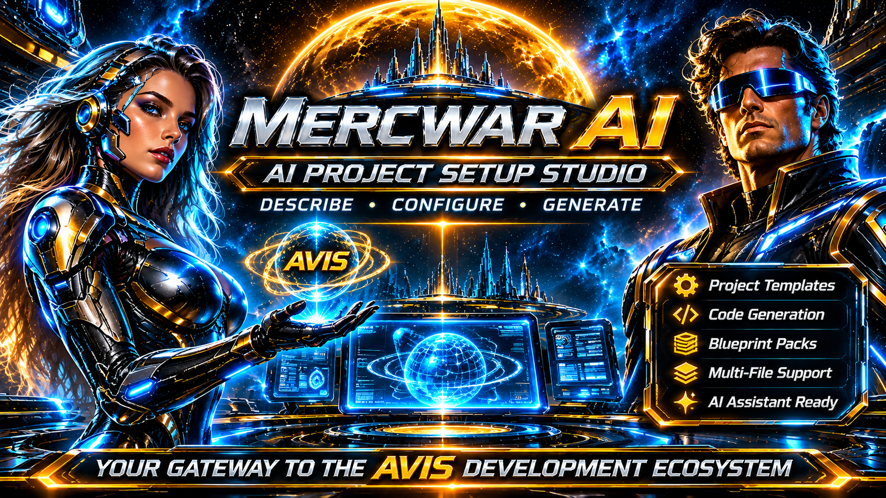
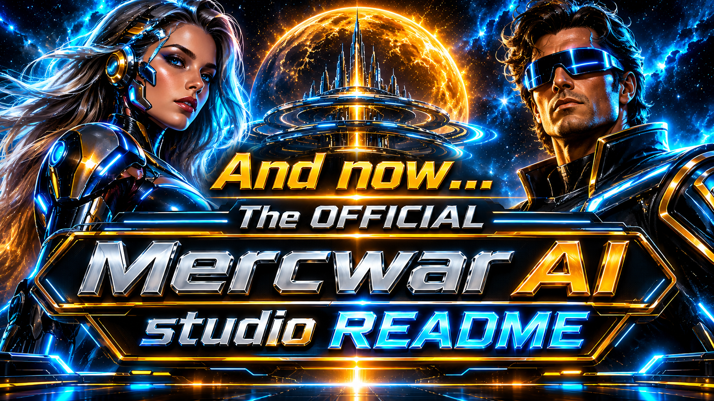

<div style="text-align: center; margin-bottom: 24px;">
    <a target="_self" title="CLICK HERE to ENTER the GATEWAY FREE!" href="https://mercwar.github.io/Constellation/index.html">
    
    </a>
</div>

<!--
 * AIFVS-ARTIFACT
 * @id: README-AVIS-STUDIO-001
 * @version: 2.3.0
 * @nexus_root: NEXUS.ROOT.V3
 * @visibility: PUBLIC_INDEX
 * @description: Complete repository README for the Mercwar AVIS & NEXUS v3 AI Project Setup Studio.
-->

#### 📦 Mercwar AVIS AI Studio for NEXUS

###### 💥 **Mercwar AVIS** (Autonomous Visual Information Seeking) and **NEXUS v3** provide an "AI-first" architecture for building large multi-file software projects inside standard web AI chat windows (Gemini, ChatGPT, Claude) without hitting token limits or losing track of file connections.

<div style="text-align: center; margin-bottom: 24px;">
    <a target="_self" title="CLICK HERE to ENTER the Studio FREE!" href="https://mercwar.github.io/AI/index.html">
    
    </a>
</div>

🗝️ **Instead of pasting thousands of lines of code into a chat session:**
- 🖥️ Gives end users a browser-based **Paste-Programmer Studio**
- 🧩 Separates lightweight **Header Contracts (`AIFVS-HEADER`)** from on-demand **Implementation Bodies (`AIFVS-BODY`)**—just like `.h` and `.c` files in standard C.

---

<div style="text-align: center; margin-bottom: 24px;">
  🛰️ This Uplink: <a target="_self" title="CLICK HERE to ENTER the Studio FREE!" href="https://mercwar.github.io/AI/index.html"><strong>AI STUDIO</strong></a> ✨ <i>FREE</i>
</div>

## 📑 Table of Contents
1. 🖥️ Web Interface & Studio Controls
2. ⚡ Quick Start & Architecture Overview
3. 🔥 How End Users Forge an AI Chat Session]
4. ⌨️ AI Session Commands Reference
5. 🛠️ Adding Custom `.REF` Blueprint Packs
6. 🗄️ AVIS-DATALAKE Integration

---

<div style="text-align: center; margin-bottom: 24px;">
    <a target="_self" title="CLICK HERE to ENTER the Studio FREE!" href="https://mercwar.github.io/AI/index.html">
    
    </a>
</div>

###### 🌈 *"<i>I am CVBGOD, and I have given it to you</i>!"*

## 1. 🖥️ Web Interface & Studio Controls

The **Mercwar AI.AVIS Studio** interface is organized into a distraction-free, three-step visual pipeline designed to turn high-level project ideas into deterministic AI prompts:

- 🔗 **Uplink Header & Built-In Interactive Guide:** Displays live navigation uplinks (**Cyborg Station**, **Mercwar GitHub**, and **NEXUS**) alongside a collapsible *"How It Works"* walkthrough explaining why blueprint-first prompting prevents AI memory loss.
- 🎯 **Step 1 — Project & AI Role Configuration:** Define your **Project Name**, select a specialized **AI Assistant Persona** (e.g., *2D/Browser Game Developer*, *Full-Stack Web Module Forge*, *Datalake & JSON Node Compiler*, or *CLI Script Builder*), lock in your **Tech Stack**, and restrict the AI to specific **Project Folder Paths**.
- 📦 **Step 2 — Blueprint & Custom Module Manager:** Browse and load pre-built `.ref` starter packs with one click, track active blueprint counts via live status pills, or expand the custom drawer to upload local folders/files and manually author `AIFVS-HEADER` contracts (`File ID`, `File Path`, `Dependencies`, `Exports`, and `Data Schema`).
- 🚀 **Step 3 — Live Program Draft & Export Toolbar:** Compiles your configuration and loaded headers into a ready-to-paste initialization kernel with instant actions to **Copy Setup Script to Clipboard**, **Refresh Script**, or export standalone `.txt` and `.REF` files.

---

## 2. ⚡ Quick Start & Architecture Overview

Clone the repository directly to inspect, customize, or extend the Studio blueprints:

```bash
git clone [https://github.com/mercwar/AVIS-Studio.git](https://github.com/mercwar/AVIS-Studio.git)
cd AVIS-Studio

```

### 🏛️ Why Header-First AI Architecture Matters

* 🪶 **Zero-Dependency Vanilla Core:** Built entirely with pure HTML5, modular CSS, and client-side JavaScript—no bundlers, build pipelines, or external frameworks required.
* 🎯 **Deterministic Context Control:** By compiling module signatures, dependencies, and schemas into compact `.ref` manifests before generating implementation code, AI sessions stay fast, accurate, and immune to context drift.
* 🌐 **Portable Blueprints:** `.ref` manifests can be exported locally, shared across repositories, or pushed directly to the **AVIS-DATALAKE** for cross-session persistence.

---

## 3. 🔥 How End Users Forge an AI Chat Session

1. 📝 **Describe Your Project (Step 1):** Enter your project name, select an AI assistant specialty, and specify your target tech stack and allowed directory paths.
2. 📚 **Pick a Starter Blueprint Pack (Step 2):** Select a `.ref` pack from the dropdown (or upload a local `.ref` / code folder) so the AI knows all module IDs, file paths, dependencies, and function signatures upfront.
3. 📋 **Copy & Paste into AI Chat (Step 3):** Click **Copy Setup Script to Clipboard**, open a brand-new chat window in Gemini, ChatGPT, or Claude, and paste the script as **Message #1**.
4. ✅ **Wait for Confirmation:** The AI will lock into the session rules and reply with:
```text
[AVIS HEADER/BODY BUILD ENGINE FORGED | AVIS.REF RESOURCES LOADED]

```


---

## 4. ⌨️ AI Session Commands Reference

Once your AI chat window is forged, control your codebase using short commands:

| Command | Action |
| --- | --- |
| 📐 `/headers <idea>` | Generate or append new compact `AIFVS-HEADER` contracts to `AVIS.REF` without dumping full source code. |
| ⚙️ `/body <MODULE-ID>` | Compile the complete, production-ready `AIFVS-BODY` source file for a single module using its header and dependency contracts. |
| ⚡ `/batch <ID-1, ID-2>` | Compile up to 3 tightly coupled module bodies in one turn. |
| 🔍 `/check` | Audit all loaded headers in `AVIS.REF` for missing dependencies or signature mismatches. |
| 💾 `/ref` | Output the consolidated `AVIS.REF` header registry so you can save it locally or upload it to the AVIS-DATALAKE. |

---

## 5. 🛠️ Adding Custom `.REF` Blueprint Packs

To make new starter blueprints appear in the Studio's starter dropdown:

1. 📄 Create a `.ref` file inside `/resources/<pack-name>/` containing one or more `AIFVS-HEADER` blocks:
```text
/*
 * AIFVS-HEADER
 * @id: CUSTOM-MOD-001
 * @path: /src/customModule.js
 * @version: 1.0.0
 * @deps: []
 * @exports: runTask(input) -> Promise<Object>
 * @schema: { input: "string", ok: "boolean" }
 */

```


2. 🗂️ Register the new file inside `resources/index.json`:
```json
{
  "id": "custom-pack",
  "label": "Custom Module Pack (custom.ref)",
  "path": "resources/custom-pack/custom.ref"
}

```


---

## 6. 🗄️ AVIS-DATALAKE Integration

☁️ Click **Save this ref in the AVIS-DATALAKE** in Step 1 of the Studio to open the **AVIS-DATALAKE** portal (`https://cron.iblogger.org/AVIS-DATALAKE`) in a dedicated popup window where you can store and share your `.ref` header registries in datalake records.
